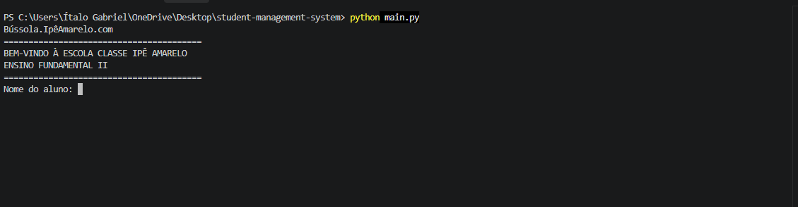
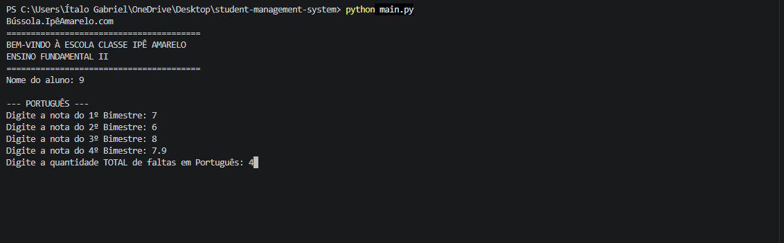
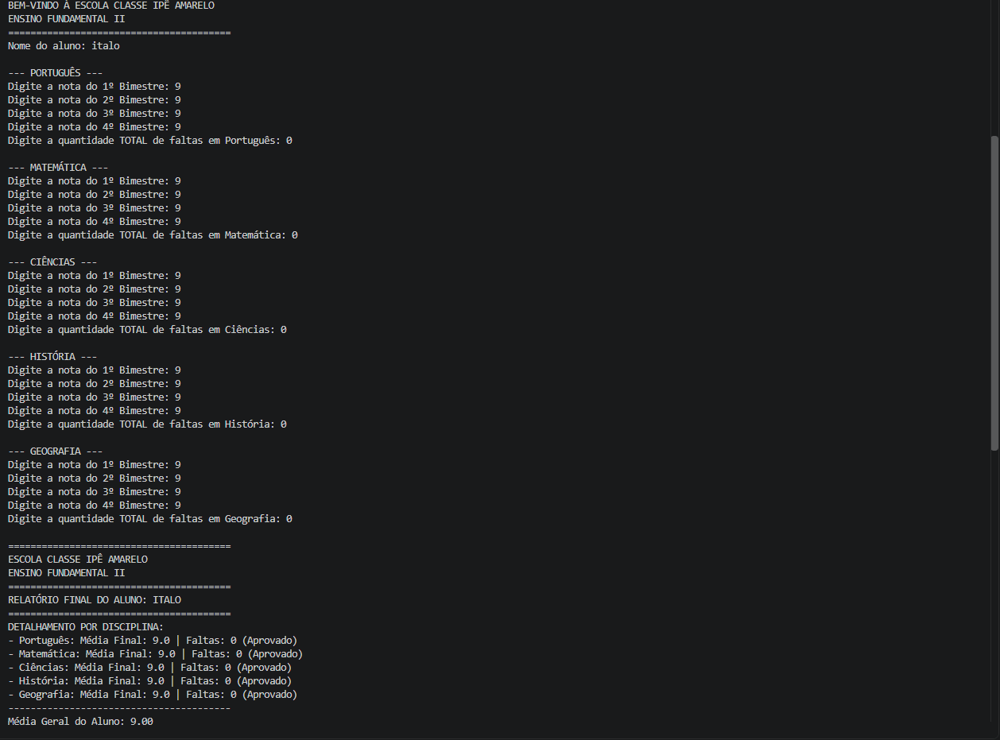

# 🎓 Student Management System

Sistema de gerenciamento de alunos desenvolvido em Python para a Escola Classe Ipê Amarelo.

O projeto funciona no terminal e permite cadastrar alunos, registrar notas, acompanhar faltas e gerar relatórios com o desempenho acadêmico de cada estudante.

---

## 🚀 Tecnologias

- Python
- Lógica de programação
- Estruturas de repetição
- Listas e dicionários
- Funções

---

## ⚙️ Funcionalidades

✔ Cadastro do nome do aluno  
✔ Registro de notas dos quatro bimestres  
✔ Cálculo da média de cada disciplina  
✔ Controle de faltas por matéria  
✔ Cálculo da média geral do aluno  
✔ Verificação da situação acadêmica  
✔ Geração automática de relatório final  

---

## 🏫 Como o sistema funciona

O programa solicita o nome do aluno e registra suas notas nas cinco disciplinas: Português, Matemática, Ciências, História e Geografia.

Cada disciplina possui quatro notas bimestrais, utilizadas para calcular a média final.

O sistema também registra a quantidade de faltas e verifica se o aluno foi aprovado, ficou de recuperação ou foi reprovado.

---

## 📊 Critérios de avaliação

O sistema utiliza os seguintes critérios:

- **Aprovado:** média igual ou superior a 7,0.
- **Recuperação:** média entre 5,0 e 6,9.
- **Reprovado por nota:** média inferior a 5,0.
- **Reprovado por faltas:** mais de 25 faltas no total.

---

## ▶️ Como executar

Certifique-se de ter o Python instalado no computador.

1. Clone este repositório:

```bash
git clone https://github.com/Biel9080/Student-management-system.git
```

2. Entre na pasta do projeto:

```bash
cd Student-management-system
```

3. Execute o programa:

```bash
python main.py
```

---

## 📷 Exemplo de uso

```text
Bússola.IpêAmarelo.com
========================================
BEM-VINDO À ESCOLA CLASSE IPÊ AMARELO
ENSINO FUNDAMENTAL II
========================================

Nome do aluno: João

--- PORTUGUÊS ---
Digite a nota do 1º Bimestre:
```

Após inserir as notas e faltas, o sistema gera um relatório com as médias e a situação acadêmica do aluno.

---

## 📚 Aprendizados

Durante este projeto foram praticados:

- Fundamentos da programação em Python
- Criação e utilização de funções
- Estruturas condicionais
- Estruturas de repetição
- Manipulação de listas e dicionários
- Validação de dados
- Operações matemáticas
- Organização e desenvolvimento de sistemas

---

## 📸 Screenshots

### Tela inicial


### Funcionamento


### Resultado


---

## 📄 Licença

MIT License.
